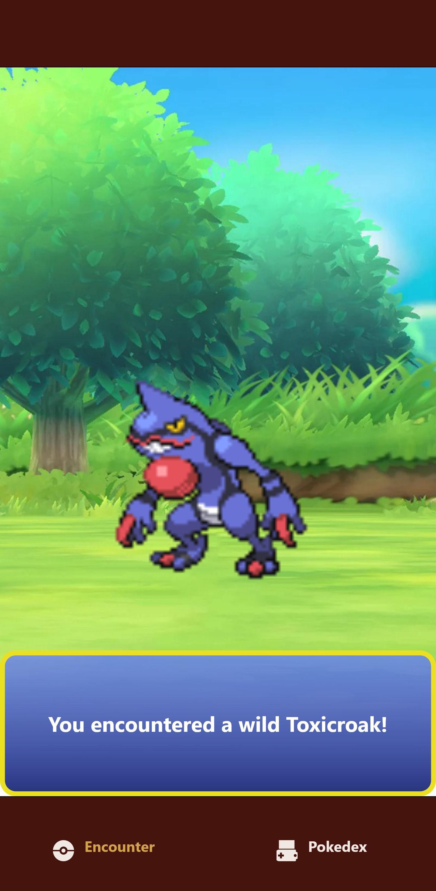
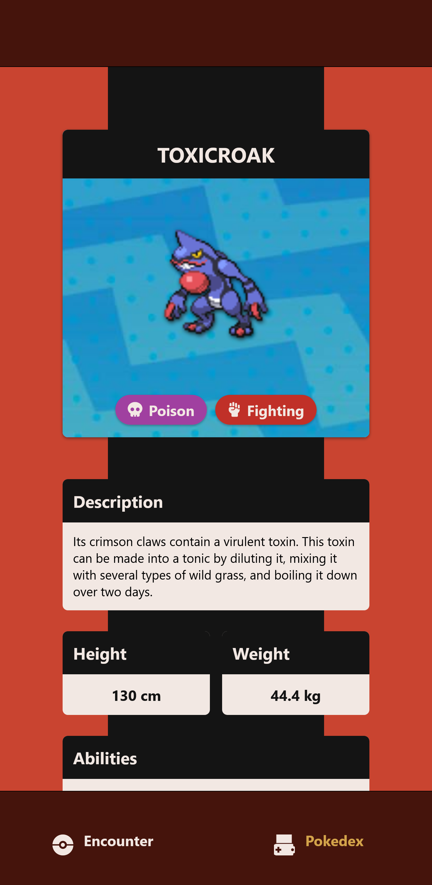

# WildPokeFinder

A small React Native app that drops you into a random wild Pokémon encounter, then lets you look that Pokémon up in a Pokédex. All data is fetched live from [PokéAPI](https://pokeapi.co/).

Originally built in college as a two-person group project, using Expo and React Native.




## Features

**Encounter tab**
- Picks a random Pokémon (Pokédex #1–1024) each time the app launches
- Shows a loading animation, then reveals the Pokémon's sprite with one of three randomly chosen idle animations (hop, shake, or tilt)
- Plays the Pokémon's cry and shows "You encountered a wild *name*!"

**Pokédex tab**
- Shows details for the Pokémon you just encountered: name, sprite, description (English), height (cm), and weight (kg)
- Shows one or two types as colour-coded pills, each with a Font Awesome icon
- Lists every ability, with the hidden ability labelled "(Hidden)"
- Shows all six base stats (HP, Attack, Defense, Sp. Atk, Sp. Def, Speed) with their total, plus a bar for each stat that is coloured by rank (red for low stats up to teal for 150+)

## Tech Stack

| Area | Tools |
| --- | --- |
| Framework | React Native 0.73, React 18, [Expo SDK 50](https://expo.dev/) |
| Language | TypeScript |
| Navigation | Expo Router 3 (file-based routing, bottom tabs) |
| Data | `fetch` against PokéAPI (`/pokemon/{id}` and `/pokemon-species/{id}`) |
| Animation and media | React Native `Animated` loops, `expo-av` for audio, `expo-linear-gradient` |
| Icons | Font Awesome 6 (through `@expo/vector-icons`) |
| Styling | React Native `StyleSheet`, Lexend via `@expo-google-fonts/lexend` |

## What I Practiced

- Fetching and displaying data from a public REST API with `fetch`, `useState`, and `useEffect`
- Handling messy API data: filtering multi-language text, optional fields, and one-or-two-item lists
- Building looping animations with the `Animated` API
- Playing audio from a remote URL with `expo-av`
- Structuring a multi-tab app with Expo Router
- Writing unit tests for the data helpers with Jest
- Collaborating on a shared codebase in a two-person team

## Requirements

This project was built on Expo SDK 50 (2024) and its dependencies are pinned to versions from that time. Running it today takes a little extra setup, mainly because current Expo Go apps no longer match SDK 50.

| Requirement | Details |
| --- | --- |
| Node.js | 20 LTS (the project pins `20.20.2` through Volta; SDK 50 needs Node 18 or newer) |
| Package manager | npm (a `package-lock.json` is included) |
| Git | To clone the repository |
| Internet connection | The app calls PokéAPI at runtime |
| A way to run it | One of the options below |

## Run Locally

### 1. Install

```bash
git clone https://github.com/<your-username>/WildPokeFinder.git
cd WildPokeFinder
npm ci
```

`npm ci` installs the exact versions in the lockfile. If you use nvm, run `nvm use 20` first.

### 2. Start the dev server

```bash
npx expo start
```

Then choose one of the options below.

### Option A: Web browser (quickest)

```bash
npm run web
```

This opens the app in your browser through `react-native-web`. It's the fastest way to look around, but the app was designed for mobile, so layout and audio may differ. Browsers often block audio until you interact with the page, so the cry may stay silent on web.

### Option B: Android phone or emulator

Expo Go in the app stores only supports recent SDK versions, so it will say the project is incompatible. Use an Expo Go build that matches SDK 50 instead:

1. Go to [expo.dev/go](https://expo.dev/go), pick **SDK 50** and **Android**, and install that build on your phone or emulator.
2. Run `npx expo start`.
3. Scan the QR code with Expo Go (phone on the same Wi-Fi network), or press `a` to open an emulator.

### Option C: iOS Simulator (macOS only)

1. Install Xcode and open the iOS Simulator.
2. Download the SDK 50 Expo Go build for the simulator from [expo.dev/go](https://expo.dev/go).
3. Run `npm run ios`, or press `i` in the Expo terminal.

A physical iPhone or iPad can't run this project through Expo Go: the App Store version no longer supports SDK 50, and older versions can't be installed on a physical iOS device. See [Expo's notes on Expo Go version mismatches](https://docs.expo.dev/troubleshooting/expo-go-version-mismatch/).

### Option D: Upgrade the project

To run it on a current Expo Go, upgrade the SDK by following [Expo's upgrade guide](https://docs.expo.dev/workflow/upgrading-expo-sdk-walkthrough). Expect to update several dependencies (notably `expo-router`, `expo-av`, and `react-native-reanimated`) and test again.

## Scripts

| Command | What it does |
| --- | --- |
| `npm start` | Starts the Expo dev server |
| `npm run android` | Starts the dev server and opens Android |
| `npm run ios` | Starts the dev server and opens the iOS Simulator |
| `npm run web` | Starts the dev server and opens the web version |
| `npm test` | Runs Jest in watch mode |

## Project Structure

```
app/
  _layout.tsx        Root layout, fonts, and splash screen
  (tabs)/
    _layout.tsx      Bottom tab bar (Encounter, Pokédex)
    index.tsx        Encounter screen: random Pokémon, animation, cry
    pokedex.tsx      Pokédex screen: details for the encountered Pokémon
components/
  Styles.tsx         Shared styles used by both screens
constants/
  PokemonTypes.ts    Colour, label, and icon for each of the 18 types
  Stats.ts           Stat labels, rank ranges, and bar colours
utils/
  pokemon.ts         Helpers that turn PokéAPI data into what the screens show
assets/images/       Icons, sprites, backgrounds, and the loading animation
```

The Pokémon ID is chosen once when the Encounter screen loads and is shared with the Pokédex screen, so both tabs always show the same Pokémon.

## Troubleshooting

- **"Project is incompatible with this version of Expo Go":** install the SDK 50 build of Expo Go from [expo.dev/go](https://expo.dev/go), as described above.
- **Stale or odd behaviour after switching Node versions or dependencies:** run `npx expo start --clear` to reset the Metro cache.
- **Blank screen:** the screens render nothing until PokéAPI responds, so check your internet connection.

## Known Limitations

- Network errors are logged to the console, but the app doesn't show an error message
- A new Pokémon is picked once per app launch, not on each visit to the Encounter tab
- Cries are `.ogg` files from PokéAPI, and playback hasn't been tested on every platform
- Dependencies are pinned to 2024 versions and haven't been updated

## Credits

Built by Jess Humphrey and Anthony Leon Lau.

Pokémon data and sprites are provided by [PokéAPI](https://pokeapi.co/). Pokémon and Pokémon character names are trademarks of Nintendo, Game Freak, and The Pokémon Company. This is a non-commercial educational project and is not affiliated with or endorsed by them.
